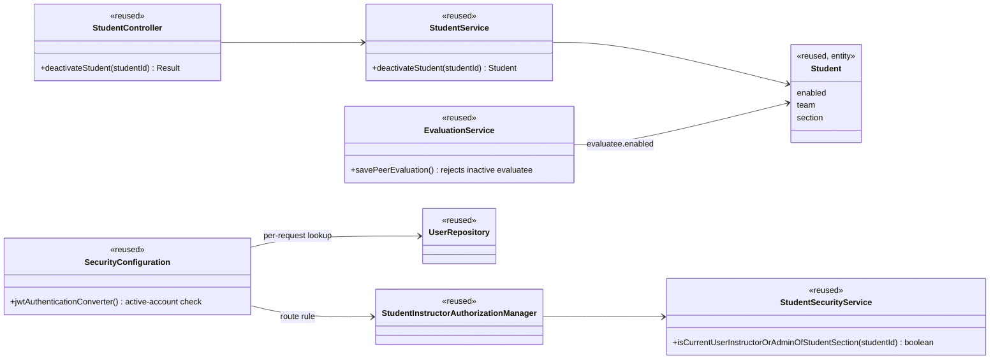

# Students (STU) Design

> Realizes: UC-STU-deactivate-student
> Depends on: FR-SEC-active-account, FR-SEC-deny-unauthorized, BR-student-lifecycle, BR-section-scoped-access, BR-role-based-access, BR-submission-owed
> See: [use cases](../requirements/use-cases.md#student), [SRS security requirements](../requirements/software-requirements-specification.md#security-and-authorization-requirements), [architectural-design.md](architectural-design.md#shared-foundation-components) (shared foundation component view, Crosscutting Concepts: authentication)
> Designed against `main` at `59f0267` (2026-11-06).

## Overview

This area covers the student account inside the foundation's `student` slice of the REST API container. The STU use cases built before this workflow (view, delete, invite, …) are recorded in [`../traceability.md`](../traceability.md) and have no design doc of their own yet; this doc starts with deactivation and grows as the other STU use cases are designed.

Before this design, deactivation existed only as the `enabled` toggle in the generic edit form (`PUT /students/{studentId}`, `StudentService.updateStudent`). It had no confirmation and no warning, any `ROLE_instructor` could flip it (BR-student-lifecycle limits it to the student's course section), and a student who was already logged in kept a working token for up to two hours (FR-SEC-active-account). Deactivation now gets its own endpoint and confirmation dialog. The security filter chain rejects a deactivated account on every request, and peer evaluations stop offering a deactivated teammate.

## Components & classes



Every class already exists; deactivation adds methods, a route rule, and a check, not classes.

- Backend: [`StudentController`](../../backend/src/main/java/team/projectpulse/student/StudentController.java), [`StudentService`](../../backend/src/main/java/team/projectpulse/student/StudentService.java), [`StudentSecurityService`](../../backend/src/main/java/team/projectpulse/student/StudentSecurityService.java), [`StudentInstructorAuthorizationManager`](../../backend/src/main/java/team/projectpulse/security/authorizationmanagers/StudentInstructorAuthorizationManager.java), [`SecurityConfiguration`](../../backend/src/main/java/team/projectpulse/security/SecurityConfiguration.java), [`UserRepository`](../../backend/src/main/java/team/projectpulse/user/UserRepository.java), [`EvaluationService`](../../backend/src/main/java/team/projectpulse/evaluation/EvaluationService.java).
- Frontend: [`Students.vue`](../../frontend/src/pages/students/Students.vue) (Deactivate control + confirmation), [`apis/student`](../../frontend/src/apis/student/index.ts) (`deactivateStudent`), [`SubmitTeamsEvaluations.vue`](../../frontend/src/pages/evaluations/SubmitTeamsEvaluations.vue) (lists only active teammates).

## Sequence

### UC-STU-deactivate-student: main success scenario

```mermaid
sequenceDiagram
    actor I as Course admin / instructor
    participant V as Students.vue
    participant API as apis/student
    participant SEC as Security filter chain
    participant C as StudentController
    participant S as StudentService
    participant R as StudentRepository
    I->>V: 1-2. find and view the student (UC-STU-view-student)
    I->>V: 3. Deactivate (offered only while enabled, ext. 3a)
    V->>I: 4. confirmation dialog: consequences + warning
    alt 5a. Cancel
        V->>I: student unchanged, no request sent
    else 5. Confirm
        V->>API: deactivateStudent(studentId)
        API->>SEC: PATCH /students/{studentId}/deactivate
        SEC->>SEC: caller's account active? section instructor or course admin? (ext. 3b, 6a)
        SEC->>C: allowed
        C->>S: deactivateStudent(studentId)
        S->>R: findById; already deactivated → reject (ext. 3a)
        S->>R: save with enabled = false, team kept
        C-->>V: Result success, StudentDto
        V->>I: 6. "student deactivated" alert; status shows Disabled
    end
```

### FR-SEC-active-account: a deactivated student who is still logged in

```mermaid
sequenceDiagram
    actor St as Deactivated student
    participant F as JWT authentication converter
    participant U as UserRepository
    St->>F: any protected request with her unexpired JWT
    F->>U: findById(userId claim)
    U-->>F: enabled = false
    F-->>St: 401; the SPA clears the token and redirects to login
    St->>F: log in again (HTTP Basic)
    F-->>St: 401 (MyUserPrincipal.isEnabled is false; existing behavior)
```

## API contract

| Endpoint or job | Caller (who may) | Request | Success | Errors, by extension |
|---|---|---|---|---|
| `PATCH /api/v1/students/{studentId}/deactivate` | an instructor of the student's course section, or the course admin of that course section's course (BR-student-lifecycle) | path `studentId`; no body | `Result` success, message "Deactivate student successfully", data: the updated `StudentDto` with `enabled` false | 3a already deactivated: `Result` failure with a conflict status code, student unchanged. 3b caller not authorized: 403. 6a unknown `studentId`: 403, because the authorization manager fails closed before the controller runs |
| every protected route (change) | — | a JWT whose account is deactivated | — | 401 (FR-SEC-active-account) |
| `POST /api/v1/evaluations` (change) | student | an evaluatee whose account is deactivated | — | rejected with `PeerEvaluationIllegalArgumentException`, like an evaluatee on another team |

## Key decisions

- **A dedicated `PATCH /students/{studentId}/deactivate`, not the edit form's `PUT`.** `PUT` rewrites every field under one rule, so it can't carry this use case's authorization, its extension 3a, or a test tagged to it. *Rejected:* keep using `PUT` with `enabled` false. `PUT`'s `enabled` toggle stays in place for now because UC-STU-reactivate-student still depends on it; it should be removed when reactivation gets its own endpoint (open question 1).
- **Immediate cutoff through the JWT authentication converter.** After the token's signature and expiry are checked, the converter loads the account by the `userId` claim and rejects a deactivated one. Authentication stays stateless (no session, no shared token state). *Rejected:* a token denylist, which adds shared state that every instance must see and so cuts against KD-self-issued-jwt's stateless model; and a shorter token lifetime, which still leaves a window and logs everyone out more often. *Cost:* one primary-key read per request.
- **Who may: an instructor of the student's course section, or the course admin of its course.** This is a new `StudentSecurityService` check beside `isCurrentUserInstructorOfStudentSection`, failing closed like every check there. *Rejected:* `hasAuthority("ROLE_instructor")`, today's behavior, which lets an instructor of any course section deactivate the student and contradicts BR-student-lifecycle and BR-section-scoped-access; and `UserOwnershipAuthorizationManager`, which would let a student deactivate herself.
- **The student stays on her team.** Deactivation changes only `enabled`. *Rejected:* removing her from the team, which would make reactivation lossy and detach her from her team's work.
- **Peer evaluations: hide her in the form and guard on the server.** `SubmitTeamsEvaluations.vue` lists only active teammates, and `EvaluationService` rejects a deactivated evaluatee, per BR-submission-owed. Evaluations already submitted are untouched. *Rejected:* filtering `GET /students/teams/{teamId}`, because instructor team views read the same endpoint and must still show her.
- **The confirmation is a frontend dialog** whose text states the consequences from the use case's Associated Information. *Rejected:* a server-side two-step confirmation token, which adds no protection beyond requiring a separate, explicit request.

## Data model

No change. `enabled` already exists on `PeerEvaluationUser`, the superclass of `Student`; see the SRS's Business Domain Model.

## Reuse & cross-cutting

- **Authentication & RBAC** (`security`): a new route rule, a new ownership check in the existing `StudentInstructorAuthorizationManager` style, and the active-account check in the JWT converter.
- **Login**: `MyUserPrincipal.isEnabled` already blocks a deactivated account from logging in.
- **Submission status** (`notification/SubmissionStatusService`): already counts only active students (BR-submission-owed); unchanged.
- **Client error handling** (`frontend/src/utils/request.ts`): a 401 already clears the session and redirects to login, which completes the cutoff on the SPA side.

## Tests

| Use case, flow | Level (unit / integration) | Asserts |
|---|---|---|
| UC-STU-deactivate-student main: an instructor of the student's course section deactivates an active student | integration | 200; `enabled` false in the database; team unchanged; her weekly activity reports and peer evaluations still present |
| main: the course admin, not an instructor of the course section, deactivates | integration | 200; `enabled` false |
| main: the service changes only `enabled` | unit (`StudentServiceTest`) | `enabled` false; team and other fields unchanged; saved once |
| 3a: the student is already deactivated | unit and integration | failure `Result` with the conflict status code; student unchanged |
| 3b: an instructor of a different course section | integration | 403; student unchanged |
| 3b: a student calls the endpoint, including on herself | integration | 403; student unchanged |
| 5a: the course admin or instructor cancels | manual (frontend) | no request is sent; student unchanged |
| 6a: unknown `studentId` | integration | 403, not 500 |
| FR-SEC-active-account: a deactivated student's unexpired JWT | integration | her next protected request returns 401 |
| FR-SEC-active-account: a deactivated student logs in | integration | 401 |
| BR-submission-owed: a teammate submits a peer evaluation of a deactivated student | unit (`EvaluationService`) | rejected; nothing saved |
| BR-submission-owed: the peer evaluation form | manual (frontend) | the deactivated teammate is not listed |

## Open questions / risks

1. `PUT /students/{studentId}` can still toggle `enabled` without the confirmation and under the broader `UserOwnershipAuthorizationManager` rule, until UC-STU-reactivate-student is designed and the toggle can be removed.
2. The design checks the course admin explicitly rather than relying on her being among the course section's instructors, so it holds whether or not she is.
3. The active-account check adds one database read to every authenticated request. That is negligible at class scale, but it is the first per-request database read in authentication.
